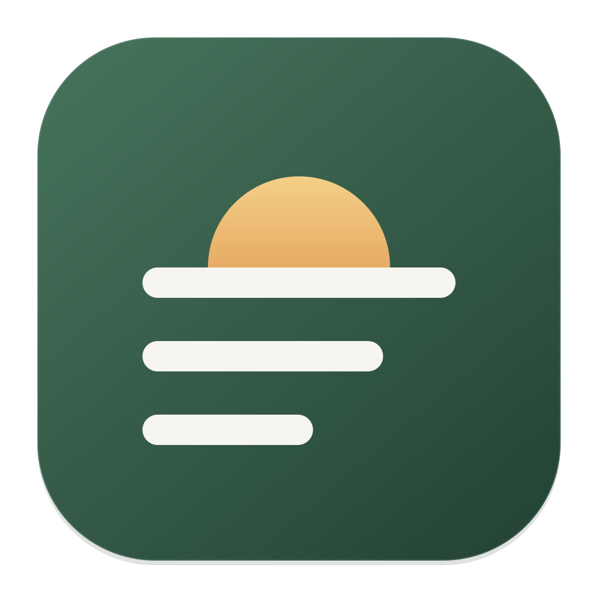
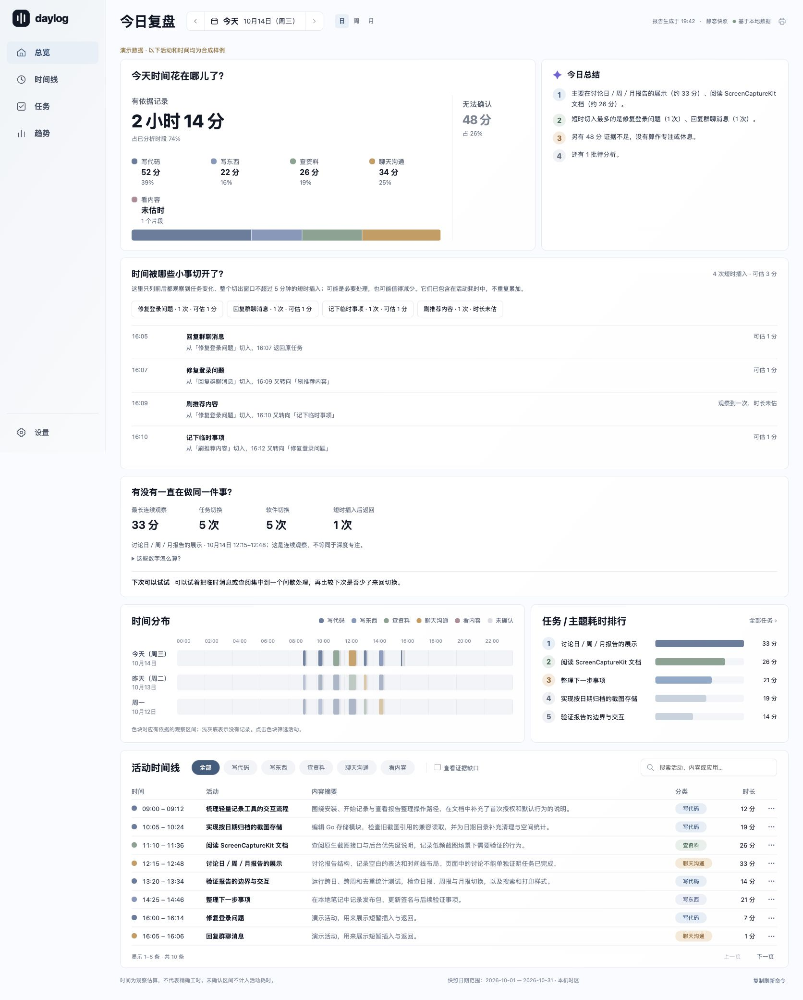

# Daylog



自动记录今天做了什么。支持 macOS 14+；Windows 10 1809+ / Windows 11 x64 适配从 0.7.0 起提供。后台采样截图，自动调用已有 Agent 的视觉模型整理成工作日记。Windows 的支持范围和验证边界见 [平台说明](skills/daylog/references/windows.md)。

## 日常只需三个命令

```sh
daylog start    # 开始记录
daylog today    # 查看今天
daylog stop     # 停止记录
```

`start` 自动创建配置、准备用户后台并检查采集条件。macOS 首次按系统提示给 Daylog 录屏授权，命令会等待并自动继续；Windows 在当前用户桌面运行，锁屏或安全桌面时暂停。不需要手动执行初始化或安装服务。重复执行不会重复启动，暂停后执行则恢复。

默认使用本机 Claude → Codex → Hermes 的已有模型配置。无需再填 API Key；模型需要支持图片，分析可能使用该 Agent 的云端服务。没有兼容 Agent 或分析失败时，截图保留在本地等待处理。Grok / Antigravity 目前仅检测。

`daylog status` 默认显示六行概览：状态、今天活动估计时长、最近截图、待整理、报告和下一步；`--verbose` 查看截图计数、进程、重试和磁盘详情。时间按本机时区显示；截图计数属于本次启动，待整理和占用包含历史。中断与失败分开统计，后台运行后会继续处理。所有结果命令默认显示便于阅读的中文；Agent 或脚本解析结果时统一加 `--json`，例如 `status --json`、`pending --json`、`agents --json`、`version --json`。`config` 默认显示隐藏密钥的配置概览，`config --json` 默认对密钥打码；确需完整导出时显式使用 `config --json --show-secrets`。打码配置导回本机时保留现有密钥。

`daylog`、`daylog -h`、`daylog --help` 都显示帮助，且不会初始化数据或启动记录。`daylog today` 先显示日期、活动数量和主要任务，再列出最多 20 项活动；估时方法只在 `--explain` 时显示。`today yesterday` 直接查看昨天，`today -h` / `help today` 显示此命令的帮助；`--full` 查看全部，`--limit N` 调整条数。`today --json` 始终导出完整记录，新增 `activities` / `activity_count` 与同日 `report --json` 使用相同的裁剪口径；原始卡片仍在 `reports` 中。单帧活动显示“时长未估”，不足一分钟的有效估计显示秒数。首批日记通常约 15 分钟后生成；它反映屏幕活动，不等于精确工时。

后台停止时，`daylog status` 正常返回并显示“已停止”；`status --json` 返回 `running:false`、`state:"stopped"` 和可读取的历史整理信息。控制连接异常且运行锁仍被持有时返回错误及 `state:"unreachable"`、`running:null`，不误报为停止。

## 安装与更新

把这一句话发给 Claude Code、Codex 或 Hermes：

```text
请按 https://github.com/cosin2077/daylog 的 README，为我安装 Daylog 和当前 Agent 的 skill，并验证安装成功。
```

<details>
<summary>Agent 安装步骤 / 手动安装</summary>

1. 确认平台：macOS 14+ 或 Windows 10/11 x64。Windows 安装要求 Release 包含 `windows-amd64` 附件；没有时说明尚未发布该平台版本，不要求用户安装编译工具。获取本仓库的 `skills/daylog`，或下载 [最新 Release 的轻量 skill 包](https://github.com/cosin2077/daylog/releases/latest/download/daylog-skill.tar.gz)。获取不到时检查 [Releases](https://github.com/cosin2077/daylog/releases)，草稿或预发布不属于默认 latest。尚无正式 Release 时明确告知，不要自动要求用户安装编译工具。
2. 将 skill 放到当前 Agent 的目录：Codex 为 `~/.agents/skills/daylog`，Claude Code 为 `~/.claude/skills/daylog`，Hermes 为 `~/.hermes/skills/daylog`。源码仓库提供 `python3 scripts/install-skills.py --agent codex`（按当前 Agent 修改）；也可直接复制目录，不要求用户安装 Python。目标已存在时比较并保留用户修改。
3. 从安装后的 skill 目录运行对应安装器：macOS 执行 `sh scripts/install-runtime.sh`；Windows 执行 `powershell.exe -NoProfile -File scripts/install-runtime.ps1`。它们只下载匹配平台的二进制，校验包摘要和固定发布身份后安装；已有安装通过更新器升级并保留配置和日记。macOS 校验 App 签名，Windows 校验 ZIP 内的 RSA 签名。
4. 验证 `daylog version` 和 `daylog -h`，告知版本。PATH 尚未生效时，macOS 使用 `~/.local/bin/daylog`，Windows 使用 `%LOCALAPPDATA%\Daylog\bin\daylog.exe`。安装到此完成；只有用户要求开始记录时才执行 `daylog start`，macOS 授权由本人完成。

macOS 应用安装到 `~/Applications/Daylog.app`，命令链接到 `~/.local/bin/daylog`；Windows 安装路径见上。预编译运行时的安装不需要 Go、Node、Python 或包管理器；skill 安装脚本只是可选便利工具。

维护者离线测试：先运行 `DAYLOG_DEVELOPMENT_BUILD=1 sh scripts/build.sh --all-arches`，再从 skill 目录执行 `DAYLOG_DEVELOPMENT_INSTALL=1 sh scripts/install-runtime.sh --source "$PWD/assets/release.json"`。此模式使用本地包和更新源；普通用户保持默认在线方式。

</details>

安装后，更新只需：

```sh
daylog update
```

默认更新源是 GitHub 最新正式 Release 的 `release.json`，首次正式 Release 发布后可用。清单中的二进制 URL 固定到版本标签；`--source` 可用于维护者的本地验证。更新验证 SHA-256、固定发布证书、签名完整性和版本/架构，校验通过后才停止旧进程。清单本身尚未独立签名；两个目录重命名之间仍存在崩溃窗口，启动失败也不会自动回滚。它由命令触发，没有后台定时更新。

正式构建使用同一张长期自签名代码签名证书。已在本机验证：0.5.0→0.5.1 的二进制发生变化，录屏授权保留且成功截图，无需再次授权。从旧版临时签名迁移时可能需要授权一次。此签名不是 Apple Developer ID，尚无 Apple 公证，首次安装仍可能有系统安全提示。用户无需安装根证书或关闭系统安全功能。维护流程见 [固定签名说明](docs/signing.md)。

## 自定义 LLM（可选）

命令行直接修改现有配置，保留其他偏好：

```sh
daylog config --endpoint https://api.example.com/v1/chat/completions --model vision-model --api-key YOUR_API_KEY
```

也可以直接编辑 `~/.daylog/config.json` 的 `ai` 部分，保留文件中其他字段：

```json
{
  "ai": {
    "enabled": true,
    "endpoint": "https://api.example.com/v1/chat/completions",
    "model": "vision-model",
    "api_key": "YOUR_API_KEY"
  }
}
```

需要支持图片的 OpenAI-compatible Chat Completions 接口；URL 是完整的请求地址，不只是域名。启用后优先使用该 API。

`--api-key` 会把密钥明文写入 `~/.daylog/config.json` 的 `ai.api_key`，也可以直接编辑这个字段。读取优先级为：JSON 明文密钥 → 指定环境变量 → 系统凭据存储（macOS 钥匙串 / Windows Credential Manager）。环境变量和 `--api-key-stdin` 安全存储方式均为可选。

修改后若正在记录，执行 `daylog restart` 生效；保留暂停到期时间与登录自启设置。`daylog config --agent auto` 切回本机 Agent；`daylog config -h` 查看完整方法。

## 所有使用数据都在 ~/.daylog

- `config.json`：配置，默认即可使用。
- `observations/YYYY-MM-DD.jsonl`：采样和状态变化；重复画面也保留时间线索。
- `frames/YYYY-MM-DD/`：按本地日期保存的新截图；旧版平铺截图兼容读取。
- `reports/`：已分析的日记；`reports/report.html` 是最近生成的可视化快照。
- 同一目录还保存待分析批次、日志和运行状态。

旧版 `~/Library/Application Support/Daylog` 会整体迁移，保留历史和配置；新旧目录同时存在时拒绝覆盖。App 与 macOS 要求的后台注册文件仍放在系统约定位置。

默认截取主屏；可通过配置选择窗口和排除敏感应用。截图是权限受限的本地明文文件。已分析原图保留 3 天，日记保留 90 天，待分析证据不会被自动清理。

## Windows

Windows 与 macOS 使用相同命令和数据布局。Agent 在 Windows 上执行 skill 的 `scripts/install-runtime.ps1`，下载匹配的 x64 二进制，安装到 `%LOCALAPPDATA%\Daylog\bin\daylog.exe`；配置和记录在 `%USERPROFILE%\.daylog`。无需管理员权限、Go 或 Python。系统执行策略或安全提示需要正常处理，不关闭系统保护。

```powershell
& <skill目录>\scripts\install-runtime.ps1
daylog start
daylog report
daylog stop
```

后台运行在当前用户会话，默认不注册登录启动；只有 `start --login` 才写入当前用户的登录启动项。`stop` 停止记录并移除该项。Windows 首版使用低频按需 GDI 截图，原生缩小后编码 JPEG，复用去重和电池策略；锁屏、安全桌面、断开的用户会话或空闲时暂停。指定窗口只捕获当前可见、前台窗口的客户区。

Windows 包和更新使用固定发布者的 RSA 签名校验，绑定版本、平台和可执行文件摘要；不要求用户安装根证书。它不等同于 Authenticode 或 SmartScreen 信誉。真实用户桌面、多屏/HDR/受保护内容和电池表现仍需要 Windows 实机验证；CI 和合成图片不能证明这些结果。实现、边界与测试见 [Windows 说明](skills/daylog/references/windows.md)。

## 在 macOS 上以什么形式运行

Daylog 是 **Go 命令行工具 + macOS App 包 + 用户级 LaunchAgent 后台服务**。`~/Applications/Daylog.app` 装有同一个 Go 可执行文件、权限身份和图标；`~/.local/bin/daylog` 是它的命令入口。App 目前没有独立窗口、菜单栏界面或 Dock 常驻界面；报告在浏览器打开。

`daylog start` 启动后台进程，退出终端或 Agent 对话不会停止记录；`daylog stop` 停止后台。`daylog restart` 重启已运行的后台，确认新进程就绪，并保留暂停到期时间和登录自启设置；未运行时用 `start`。默认不登录启动，按需使用 `start --login`。后台使用较低进程优先级和低优先级磁盘 I/O；截图由少量原生桥接代码调用 ScreenCaptureKit。

## 开始记录后会发生什么


### 电脑工作估时

`daylog status` 和 `daylog today` 区分电脑工作总估时、已归类任务、仅应用与其他未归类时间；日、周、月和时段报告使用同一计算方式。连续且间隔有界的可用采样即使没有识别出任务，也保留在工作估时中；已知前台应用时显示应用名，不自动分配到具体任务排行或连续专注。前后任务可靠、仅有意料外的新图片未进入模型输入且不超过3分钟时，可补为邻接推断；模型实际看过却无法识别的图片继续作为边界。当前草稿和待整理采样可以计入本地工作估时；「待整理0段」不代表所有时间均已归类。

新配置默认连续无键鼠输入20分钟后按离开处理，可用 `daylog config --idle-minutes 20` 设置，`--idle-minutes 0` 关闭此判断。已存在的配置不会被升级悄悄改写，修改后运行 `daylog restart`。前20分钟可包含阅读或思考估时，从达到阈值时起不计工作，恢复输入后继续。锁屏、息屏及休眠不计电脑工作；暂停、采集失败或长时间缺测单列，不能据此判断没有工作。该口径适合主要基于电脑工作的使用方式，估时不等于确认注意力。

历史只按已存在的采样时间重新汇总，不重新识图或改写活动解释，也不补造旧空闲阈值停止采集期间的数据。JSON 的 `work_time` 包含总估时、已归类、仅应用、其他未归类、未工作和采集不足；已有 `estimated_seconds` 保持任务估时含义。

`daylog start` 准备后台服务并检查权限，按电源和空闲策略采样。相似画面复用同批截图，仍保存观察时间；应用切换、锁屏、空闲和采样中断留下状态边界。默认约 15 分钟封批，目标选 4 张、最多 8 张，优先保留应用切换，再兼顾内容变化和时间分布；明显内容变化最多增加两张，但不增加模型调用次数，也不会越过每批上限。稳定画面可能只需一张。旧配置中明确设置的上限继续生效。

后台每分钟检查待分析队列：优先使用自定义 API，否则尝试 Claude → Codex → Hermes。每次提交新批截图及最近 30 分钟内最多 5 个任务的短摘要，模型可关联已知任务；程序分配稳定的任务／活动 ID。失败保留队列，按 15 / 30 / 60 分钟递增退避（最长 6 小时）自动重试，新批次优先；受每日 192 次尝试和 1536 张提交图片预算约束，重试同样计费计数。旧版已达三次上限的批次也会恢复调度，不清零累计次数或每日账本。Agent 内部请求次数/token 不一定可知；API 返回的 token 用量会记录到 `usage/`。

**模型辨认活动，程序估算时间。** 0.9.0 在原有连续观察之外加入有上限的相邻观察推断：任务变化时按中点划分，有应用切换事件时用该时间定位；邻图未识别时只推断已识别一侧的半段。间隔还受采样上限和 300 秒硬上限约束，锁屏、空闲、缺失、冲突和长空洞继续留空。总估计中的推断时长单独显示，JSON 使用 `inferred_seconds`；最长连续观察不会因此变长，也不能据此称为深度专注。旧报告只在内存中复用归档状态，不重写历史 JSON、不读取图片或重复调用模型；缺少可靠元数据则保留不确定性。旧版模型时间范围仍单独标记。

内置提示词与 [JSON Schema](internal/journal/analysis_schema.json) 要求只描述可见事实，不能把编辑当完成或把截图文字当指令，不抄录凭据和完整聊天。运行 `daylog prompt` 查看新版提示词；升级前待处理批次仍使用旧格式。新报告保存 `schema_version: 2`、任务/活动 ID、实际估算区间、未知区间、提示词版本及输入摘要哈希。已提交结果不可覆盖；人工修订和原生编码前去重等后续事项见 [设计与实施状态](docs/analysis-design.md)。

## 日／周／月可视化报告

```sh
daylog report
```

浏览器中打开一个离线 HTML，先看与首个任务排行一致的结论和三个关键数字，再看全宽任务 Top 5、合并相邻同类区间的当天时间轴、短时切换来源 Top 3 和一条建议。完整记录、其余来源与估时说明默认折叠，长标题完整换行，手机端使用紧凑单栏。支持日期导航、关键词搜索、类型/任务筛选、分页和打印 / 保存 PDF。

日报按本地日历日，周报按周一到周日，月报按自然月；跨日片段拆分展示，重叠时间做合并统计。“记录覆盖”合并新版有效估算区间与旧版模型区间；报告分别显示观察估计、旧版范围和已分析批次内的未知时间。未知量不代表全天所有缺口，未记录或未分析时段也不代表没有工作。

周报提供每天的活动时长与切换趋势，月报提供日历热力图，不绘制未来日期。三个关键数字与前一天、上周或上月比较；本期尚未结束时按已过的日期和时刻对齐，上月较短时截止月末。上期没有可比记录时不显示变化百分比。记录天数和覆盖不同仍会影响比较，需结合内容判断。周/月有各自的选择器、前后导航和建议；也可直接运行 `report week` / `report month`。

报告也帮助你回顾短时切换：具体活动使用“写代码、写东西、查资料、聊天沟通、看内容、玩游戏、处理杂事”分类；旧的粗分类保留来源，无法细分时显示“未细分”。证据缺口独立显示，不作为活动类别。

**时间碎片**列出什么时候从原任务转去处理什么、何时返回或再转向其他事，并按去向汇总次数和可估时长。默认识别前后都有可信任务观察、整个切出窗口不超过 5 分钟的短时插入；只见一帧也保留，但不编造时长。片段耗时是已有活动时间的子集，不能重复相加。持续更久的活动仍在完整时间线中。

**连续性**区分软件切换与任务切换，显示最长连续观察、短时返回和一条可尝试的调整。只有相接的同任务证据区间才合并，未知时段会切断。它不是深度专注评分，也不按“切一次损失固定分钟”扣时间。微信可以是工作沟通，浏览器可以是查资料或刷内容：依据可见内容判断，不能单凭软件名判断动机。没有识别出切换不代表没有分心。

新分析会保存 `task_observations`；旧报告没有这些字段时会显示切换证据不足，不重新识图或改写历史记录。生成这些统计不增加截图、权限或 LLM 请求。可选目标、用户纠正和更细的事件采样尚未实现；当前 5 分钟识别窗口是固定统计口径。

周／月报告复用已有模型分析结果进行本地汇总，不会重新上传截图或额外请求模型。当前概述是统计性描述，尚未增加第二层 LLM 长文总结。报告按需生成，避免后台反复扫描整月；输出到 `~/.daylog/reports/report.html`，下次生成替换上一次快照。HTML 不附带原始图片或模型配置，也不会读取配置中的密钥；不依赖远程脚本、字体或服务。它仍包含日记内容，是私有明文文件。

```sh
daylog report --period week              # 本周视图
daylog report --period month             # 本月视图
daylog report --date 2026-10-13           # 指定日期所在的日／周／月
daylog report --period week --json       # 供 Agent 读取的结构化汇总
daylog report --no-open                  # 只生成 HTML
daylog report --from 2026-10-13T14:00:00+08:00 --to 2026-10-13T16:00:00+08:00 --json
```

没有记录的日期会明确提示最近有记录的日期，保留已有 HTML。生成后是静态快照，生成时间和整理状态放在页脚；`status` 也会提示已有新分析结果。新活动需要重新运行 `daylog report` 才会更新。下图使用演示数据。



## 省资源的默认行为

截图间隔可配置：默认插电时至少间隔 90 秒，电池时约 120 秒。相似画面不重复存图，但保留观察时间；每个新批次会重新留一张当前画面。每批目标 4 张、最多 8 张。电池供电默认不分析；低电量、锁屏、屏幕休眠或严重热压力暂停，不阻止系统睡眠。

在 `~/.daylog/config.json` 中，`min_save_seconds` 控制最小截图间隔，`interval_seconds` 控制检查周期。例如要在插电时约每 30 秒采样，把两者都设为 `30`，保留其他配置；电池与低电量模式仍分别使用 `power.battery_interval_seconds`、`power.low_power_interval_seconds` 降频。检查周期不能大于最小截图间隔，实际采样还受空闲、锁屏等策略约束。修改后重新启动正在运行的记录即可生效，也可以直接让 Agent 帮你调整。

也可直接选择档位，修改后重新启动记录：

```sh
daylog config --profile balanced  # 默认：90 秒采样，15 分钟分批，目标 4 / 最多 8 张
daylog config --profile battery   # 120 秒采样，30 分钟分批，目标 3 / 最多 6 张
daylog config --profile detailed  # 30 秒采样，10 分钟分批，目标 6 / 最多 12 张
```

每日调用尝试 / 图片预算分别为：均衡 **192 / 1536**、省电 **96 / 768**、精细 **288 / 2304**。这是上限，不是目标消耗量。已保存的自定义额度不会被更新覆盖；需要采用新版额度时重新选择档位，或编辑配置。

电池采样分别为 120 / 180 / 120 秒；档位不启用电池分析，也不修改模型、密钥、屏蔽应用和窗口设置。高级配置包括 `target_images_per_batch`、`max_images_per_batch`、`max_images_per_day`、`max_observation_gap_seconds`（连续估算最大间隔，默认 300 秒，相邻采样还取实际采样间隔的两倍作为更严格上限；插值两端关键帧也不能超过此配置上限）。`heartbeat_seconds` 为旧配置保留；v2 使用真实重复观察替代定时保存重复图。

Go 后台在 macOS 调用 ScreenCaptureKit，在 Windows 调用 GDI；采集无需 WebView 或 Node。Windows 适配使用 `go-winio` 和 `x/sys`，许可随包分发。旧版 macOS 已有实机后台内存短样本约 27–30 MiB（不代表新版或 Windows 测量）；实际电池续航尚未测量。小网格可能漏掉细微文字修改，长时间无输入的阅读也可能被当作空闲。

## 分析日志与失败恢复

`~/.daylog/logs/llm/YYYY-MM-DD.jsonl` 记录每次请求和响应，超过约 1 MiB 自动轮转。可按 `request_id`、`batch_id` 关联：`payload` 包含 Daylog 的提示词、上下文和图片文件/哈希引用，`response` 保存模型返回文本；还记录耗时、退出码、HTTP 状态、失败阶段及脱敏 stderr。API 模式的 response 是接口返回体，Agent 模式是 CLI 返回的模型结果；Agent 内部附加提示词、HTTP 重试与完整网络 payload 不一定可见。

不记录 Authorization 请求头和图片 Base64，过滤已知凭据及常见密钥格式。日志仍可能含工作内容，应按私有数据对待；目录 0700、文件 0600，默认保留 7 天、总上限 32 MiB。单个响应最多记录 128 KiB、stderr 最多 8 KiB，截断会标记。可在 config.json 的 `diagnostics` 中设置 `enabled`、`retention_days`、`max_bytes`。

本机 Agent 默认单次上限 180 秒，可用 `daylog config --agent-timeout 240` 修改（10–600 秒），不改变模型或回退顺序。超时期间观察到的上游重试会单独标记；延长时限不能保证网络或模型故障恢复。`agent.effort` 默认为 `low`，可改成 `inherit` 使用 Agent 原配置，或 `medium` / `high`。这些设置只作用于 Daylog 的子进程；Codex 插件/hooks/记忆加载被关闭，Claude 使用保留认证/模型选择的 safe mode。不会修改全局 Agent 配置。老配置中明确保存的 90 秒仍保留。

`daylog status --verbose` 显示整理详情、失败段数、最近成功和下次重试。`doctor` 显示系统策略、模型安装与最近整理结果，不会额外截图、调用模型或把历史成功当作当前连通。需要立即重试某段时，先用 `pending --json` 获取编号：

```sh
daylog pending --json
daylog analyze 记录编号 --retry
```

手动重试不清除历史次数、不绕过每日额度和电源策略。`daylog update` 和手动分析在终端显示 loading；`--json` 不混入进度输出。

## 让 Agent 操作

配套 skill 可供 Claude Code、Codex、Hermes 使用。源码目录中运行：

```sh
python3 scripts/install-skills.py --agent all
```

脚本复制 skill 的说明和安装器，源码 skill 无需附带二进制；复制 skill 不会启动记录。Agent 随后运行对应平台安装器，自动下载 macOS arm64 / amd64 或 Windows x64 包，无需现场编译；正式 Release 尚无该平台附件时会明确报错。

之后直接说“用 Daylog 开始记录”“看看今天做了什么”“停止记录”。Agent 使用同一套简单入口；用户无需理解截图批次或服务管理。

**安装之后，也可以直接让 Agent 解读已有记录：**

> 用 Daylog 看看今天下午我主要在忙什么，大概花了多久，哪些时段还没有分析。
>
> 根据 Daylog 总结本周做了哪些事，并生成一份可视化报告。

给 Agent 的读取约定：先用 `daylog report --period day|week|month --date YYYY-MM-DD --json` 获取相关时间范围的活动、记录覆盖、待分析和未封批数量；需要原始卡片时用 `daylog today --date YYYY-MM-DD --json`。仅查询某几小时则使用 `report --from RFC3339 --to RFC3339 --json`；时间必须带时区，程序会裁剪并合并有效区间。普通总结复用已有 JSON，不启动截图或重复分析图片。用人话概括任务和可见进展，将时间标为估计覆盖，并说明缺口；不把空白当休息。

需要可视化时执行 `daylog report --no-open`，返回 HTML 路径。详细的 [数据目录与 JSON 读取说明](skills/daylog/references/data-layout.md) 随 skill 一起分发，包含 `frames`、`batches`、`archive`、`reports`、`draft.json` 的用途。`config.json` 可能含密钥，回答活动问题无需读取它。

高级设置、自定义 API、指定窗口和排障见 [命令参考](skills/daylog/references/commands.md) 或 `daylog help --advanced`。默认不启用登录启动；需要时使用 `daylog start --login`，`daylog stop` 会一并关闭它。

开发：`go test -race ./...`、`go vet ./...`、`DAYLOG_DEVELOPMENT_BUILD=1 sh scripts/build.sh --all-arches`。实测范围见 [验证记录](VALIDATION.md)。

图标源文件为 [daylog.svg](assets/icon/daylog.svg)，修改后在 macOS 执行 `sh scripts/build-icon.sh`（需要本机 `rsvg-convert`）重新生成 PNG / ICNS。普通构建直接使用仓库内的 ICNS，不增加安装或运行依赖。

## GitHub 自动构建与发布

- PR 和 `main` 推送：在 macOS 15 的 arm64 / Intel runner 上运行测试、构建和隔离安装验证；Windows 2022 runner 运行 Go 测试、PowerShell 5.1/7 安装与后台/自更新验证。
- 推送 `v0.7.0` 这样的数字版本标签：构建 macOS 双架构包和 Windows x64 包，生成版本固定的更新清单和轻量 skill 包，上传 Actions artifact 并创建 **Release 草稿**；另在 Windows runner 验证正式签名包的安装与自更新。
- 也可手动运行 “Build release” workflow，传入已经存在的标签。重跑只替换同标签草稿附件；已发布版本拒绝覆盖。
- 维护者验证后将草稿发布为正式 Release，并设为 Latest，Agent 默认安装及 `daylog update` 才会使用它。CI 不会自动开始用户录屏。

版本标签应指向已提交的发布代码。配置步骤、产物与验证边界见 [发布说明](docs/releasing.md)。


### 识图与失败恢复

识图默认使用低 effort，提示词只要求简短的活动标题、事实摘要和截图引用。可选字段由程序补齐，接受 JSON 代码围栏；时长始终由本机观察计算。缺少截图证据、引用不存在的图片或错误批次仍会拒绝，避免把猜测记成事实。

可以指定 Agent 顺序，并把自定义视觉 API 作为最后回退：

```sh
daylog config --agent claude,hermes
daylog config --endpoint https://api.example.com/v1/chat/completions --model VISION_MODEL --api-fallback --fallback-models BACKUP_MODEL
# 密钥推荐通过 daylog config --api-key-stdin 写入钥匙串；也可编辑私有 config.json
```

对应 `agent.order`、`ai.fallback_after_agents` 和 `ai.fallback_models`。不设置回退时，自定义 API 保持直接调用模式。回退仅在前一个候选失败后发生，不并行上传，也不会绕过调用/图片预算。

全部候选失败才算一轮，15/30/60 分钟递增退避，最长 6 小时。首次失败后连续重试失败超过 5 次（总计第 7 轮失败）提交一次系统通知，同一批次不重复打扰；是否展示横幅由系统通知设置决定。停止/取消、电源暂停和预算耗尽不计入失败轮次。`status`、`pending` 和报告均显示失败状态，报告内可以复制具体重试命令：

```sh
daylog analyze --batch 批次ID --retry
```

报告的时间分布、类别占比、活动时间线和主要任务均来自已保存结果。分类按可估算时间统计，旧模型时段与未知时间单独提示；HTML 是离线快照，复制重试命令后需要在终端执行，再运行 `daylog report` 刷新。

系统通知默认开启，可用 `daylog config --notifications=false` 关闭，或设置 `diagnostics.failure_notifications: false`。开关不影响重试、状态、日志及报告中的失败提示；修改后重启后台生效。

新版报告提供日期导航、日／周／月视图、实际观察区间的时间分布、任务排行和表格时间线。可搜索活动、摘要或应用，展开查看截图依据。未确认区间通过独立筛选查看，不冒充活动。日期导航限于快照包含的日期；其他月份可通过 `report --date YYYY-MM-DD` 生成。今日总结由已保存的分析结果和统计组成，生成报告不会新增 LLM 请求。

相接的同任务活动会合并，分项说明和来源在 JSON `parts` 中保留；同标题不会自动合并。单点或同一分钟内的条目只显示起点，避免看起来像零长度区间。具体规则和未采纳建议见 [v4 处理说明](docs/ux-review-v4.md)。

## Notion 每日同步

运行 `daylog notion setup`，在终端隐藏输入 API Token 和目标页面链接。Daylog 使用一个数据库，每天一页，只有名称、日期和状态三个字段；详细活动按时间写在正文。手动 `daylog notion sync` 默认今天并确认日期，`--date YYYY-MM-DD` 可直接同步指定日期；同一天后续补齐更新原页面并保留「我的备注」。后台每天 00:00 同步前一天；可用 `daylog notion schedule --times 12:00,16:00,18:00,20:00,22:00` 增加白天备份。恢复运行或联网后补传最新记录，不上传截图。已有兼容库可用 `setup --database <库链接>` 接入；首次配置后保持后台运行，`notion sync --dry-run` 可先检查内容。[配置、数据字段与恢复说明](docs/notion-sync.md)。
